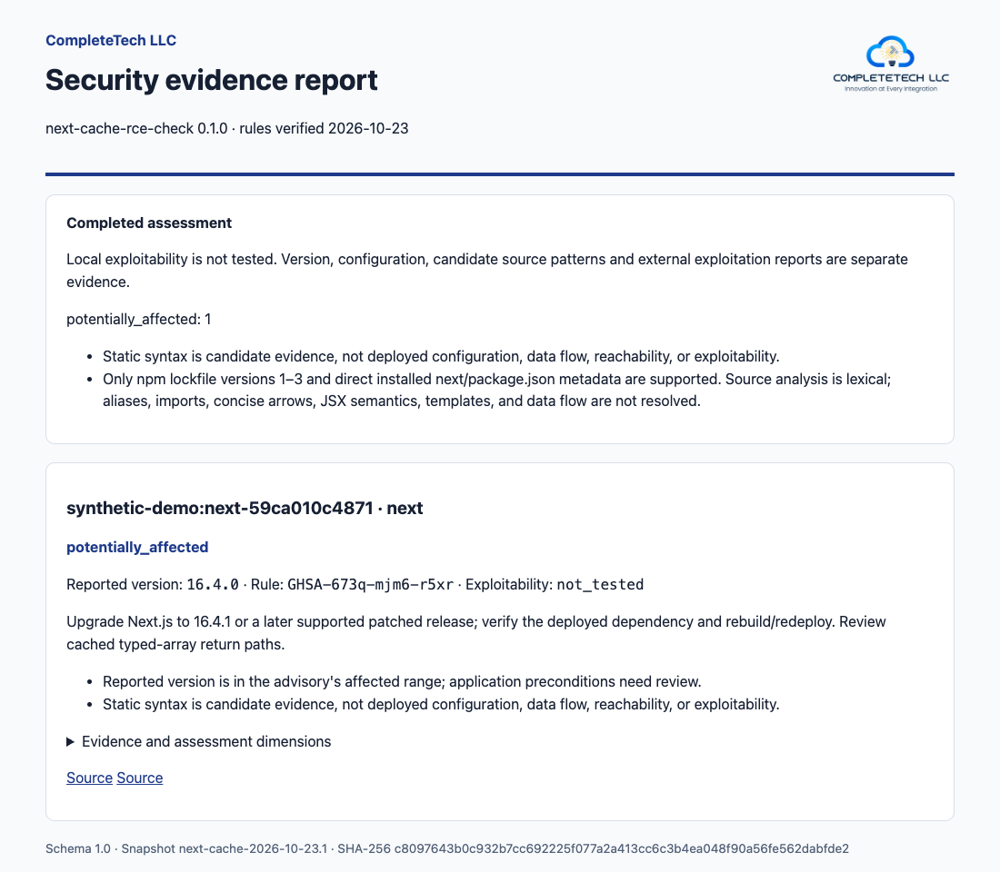

<p align="center">
  
</p>

<p align="center">
  <a href="https://github.com/completetech-security/next-cache-rce-check/actions/workflows/tests.yml"></a>
  
  
  <a href="LICENSING.md"></a>
</p>

<h1 align="center">next-cache-rce-check</h1>

<p align="center">
  <b>Offline triage for the Next.js use-cache typed-array RCE</b><br>
  <a href="https://github.com/vercel/next.js/security/advisories/GHSA-673q-mjm6-r5xr">GHSA-673q-mjm6-r5xr</a> · offline, single-file, dependency-free
</p>

`next-cache-rce-check` assesses reported Next.js versions, npm dependency metadata, and bounded JS/TS source context against the maintainer advisory for this one issue. It exports canonical JSON, CSV, or a branded HTML report.

It never executes project code, invokes a package manager, or contacts the network. It reports uncertainty honestly: missing, conflicting, or qualified evidence is `unknown`, never "safe".

> [!IMPORTANT]
> **Potential exposure is not confirmed exploitability.** Every result keeps `exploitability: not_tested`. A reported version, lockfile, or source pattern cannot show deployed configuration, vendor backports, or real patch status. Treat each result as a prompt for a maintainer to check.

It follows the conservative reporting and licensing approach of [node2shell-check](https://github.com/completetech-security/node2shell-check) and [php2shell-check](https://github.com/completetech-security/php2shell-check).

## Contents

- [Scope](#scope)
- [Requirements](#requirements)
- [Quick start](#quick-start)
- [Usage](#usage)
- [Interpreting results](#interpreting-results)
- [Reports and output](#reports-and-output)
- [Exit codes and incomplete coverage](#exit-codes-and-incomplete-coverage)
- [Limitations and bounds](#limitations-and-bounds)
- [Documentation](#documentation)
- [Development and provenance](#development-and-provenance)
- [License](#license)

## Scope

The maintainer advisory identifies **Next.js 16.0.0 through 16.4.0** as affected and **16.4.1** as fixed. Its application conditions are App Router, Cache Components, and a use-cache function that returns multiple typed arrays. The maintainer advises upgrading even when the application does not appear to contain matching functions, and lists no known workaround for affected code. See the [advisory](https://github.com/vercel/next.js/security/advisories/GHSA-673q-mjm6-r5xr) and the [16.4.1 release](https://github.com/vercel/next.js/releases/tag/v16.4.1).

| Release line | Affected (reported) | Fixed in |
| --- | --- | --- |
| Next.js 16.0 to 16.4 | 16.0.0 to 16.4.0 | 16.4.1 |

The embedded snapshot was verified **2026-10-23** against the maintainer advisory. No CVE identifier was assigned in the advisory at verification time.

This checker classifies only plain exact versions on the verified 16.0–16.4 release lines. Earlier major versions, prereleases, vendor-qualified versions, and future 16.5+ lines remain `unknown`. It does not establish whether a reported build was released or whether a vendor backport is present.

## Requirements

- Python 3.10 or later on Windows, macOS, or Linux, using only the standard library.
- Either the standalone `next_cache_rce_check.py` file or a clone of this repository.
- A local project copy you are authorized to read, or a separately obtained Next.js version string. Paths are local; URLs are not inputs.

No Node.js, package manager, network connection, or third-party package is needed.

## Quick start

```sh
# Compare a version obtained from your deployed dependency.
python next_cache_rce_check.py --next-version 16.4.0

# Inspect a project copy you are authorized to read.
python next_cache_rce_check.py /path/to/project --asset-id service-a

# Save an offline HTML report, with optional branding.
python next_cache_rce_check.py /path/to/project --format html --brand "Example team" --logo team.png --output report.html

# Save canonical JSON for automation; exit 1 on an affected reported version.
python next_cache_rce_check.py /path/to/project --format json --output report.json --fail-on-finding

# Try the artificial fixture without installing anything.
python next_cache_rce_check.py examples/synthetic-project --asset-id synthetic-demo
```

The fixture is artificial and should report `potentially_affected` (see [examples](examples/README.md)). Do not install or deploy it.

## Usage

Supply a project directory, at least one `--next-version`, or both. There is no implicit scan of the current directory. `--help` lists all arguments and `--version` prints the tool version.

| Option | Purpose |
| --- | --- |
| `PROJECT` | Stable application root directory. Run once per application; workspace package graphs and arbitrary nested roots are not resolved. |
| `--next-version VERSION` | A reported version of the root Next.js instance. Repeat to preserve multiple observations; disagreement is reported as a conflict, not resolved. |
| `--asset-id LABEL` | Non-sensitive label (default `project`). |
| `--format {json,csv,html}` | Report format (default `json`). |
| `--output PATH` | Write the report to a file outside the assessed project directory instead of stdout. |
| `--force` | Replace an existing report file. Without it, existing files are preserved. |
| `--brand NAME`, `--logo PATH` | HTML display name (default `CompleteTech LLC`) and an optional local PNG/JPEG/GIF/WebP logo. |
| `--fail-on-finding`, `--fail-on-unknown` | Exit 1 on a completed report containing `potentially_affected` or `unknown` results, respectively. |

Report destinations must be outside the assessed project directory, including when `--force` is used; the checker never writes into the project tree. Accepted exact versions remain attached to their individual evidence sources in JSON, CSV, and HTML even when disagreement makes the selected version unknown. To assess a separately verified version without unsupported project metadata, use `--next-version` alone. Argument syntax, value limits, and protections are in the [CLI reference](docs/REFERENCE.md).

### Inputs inspected

| Input | Treatment |
| --- | --- |
| `package-lock.json` / `npm-shrinkwrap.json`, npm versions 1–3 | Extract exact resolved Next.js versions, preserving nested instances, canonical npm aliases, and disagreements. A lockfile does not attest installation. |
| Direct `node_modules/next/package.json` | Read package identity and reported installed version; disagreement with the lockfile stays unknown. |
| `package.json` | Record a dependency-declaration candidate. Exact pins and ranges both remain declarations, never installed-version evidence. |
| Yarn, pnpm, Bun lockfiles | Explicitly unsupported. Coverage is incomplete and exit code is 2; unsupported inventory prevents a fixed assessment. |
| JS/TS and conventional App Router files | Bounded lexical context only. No import graph, value-flow analysis, runtime evaluation, or reachability check. |

Source evidence is attached only to the direct `node_modules/next` instance; nested copies have their own version results.

## Interpreting results

| Result emitted by this CLI | Meaning |
| --- | --- |
| `potentially_affected` | An exact reported/resolved version is in 16.0.0–16.4.0. Review application conditions and prioritize upgrade. |
| `fixed_version_reported` | An exact 16.4.x reported version meets the 16.4.1 fix threshold. Installed patches and deployed state are not independently attested. |
| `unknown` | Evidence is absent, conflicting, qualified, malformed, outside this snapshot, or incomplete in a way that prevents a fixed-version conclusion. |

Every result retains `exploitability: not_tested`. This lexical scanner emits source **candidates**, with relative paths and lines, and keeps precondition states `unknown`. A cached function and an array expression in unrelated functions are not combined. Even a literal `cacheComponents: false` remains candidate configuration evidence; wrappers, conditional settings, and deployed configuration are not evaluated. No match does not establish absence or safety.

The canonical [contract](docs/CONTRACT.md) reserves additional statuses for checkers with stronger evidence; this CLI does not emit them. A reported fixed version is not a verified deployed patch.

## Reports and output

JSON is the canonical report. CSV and HTML render the same results, completeness, provenance, and evidence, so CSV and JSON suit spreadsheets and pipelines. `--format html` produces a single self-contained, script-free file with your logo, a completeness summary, and every result with its evidence. It follows the reader's light or dark theme and prints cleanly. Use `--brand "Your Company"` and `--logo path/to/logo.png` to brand it for your own organization.

<p align="center">
  <picture>
    <source media="(prefers-color-scheme: dark)" srcset="docs/images/report-dark.png">
    
  </picture>
</p>

<p align="center"><sub>Synthetic example from the artificial <code>examples/synthetic-project</code> fixture. <a href="docs/example-report.html">View the HTML</a>.</sub></p>

### Provenance

Run envelopes retain the UTC generation time, the actual standalone executable SHA-256, and the rules snapshot ID, date, and hash in JSON, CSV, and HTML, including empty or incomplete summaries. These identify report generation and code bytes; they do not attest deployed state, patch authenticity, or evidence acquisition.

### Privacy and output protections

- CSV neutralizes spreadsheet formula prefixes; HTML is script-free and escapes text.
- Reports omit source snippets, absolute paths, environment variables, and raw malformed version strings.
- Relative filenames and caller-provided asset labels can still identify a project; review reports before sharing, and keep real reports outside this repository.
- Existing report files are preserved unless `--force` is supplied, and report destinations outside the project tree are required either way.

## Exit codes and incomplete coverage

- **Exit 0:** report completed; by default this does not assert a safe result.
- **Exit 1:** `--fail-on-finding` or `--fail-on-unknown` matched a completed report.
- **Exit 2:** invalid arguments, operational failure, or incomplete input coverage.
- **Exit 130:** interrupted project scan; completed observations are preserved in an incomplete report when output succeeds.

Incomplete coverage takes precedence over policy exit 1. Source-only gaps can coexist with an independently established `fixed_version_reported` result; the report remains `complete: false` and exits 2. Incomplete inventory blocks that fixed-version conclusion. An interrupted project scan preserves completed observations and marks coverage incomplete; interruption during inventory also blocks a fixed conclusion. A malformed root, an output failure, or interruption during output can prevent report creation.

Operational failures and incomplete coverage are not assessment results; only `potentially_affected`, `fixed_version_reported`, and `unknown` are.

## Limitations and bounds

Limits include 4 MiB per JSON file, 1 MiB per source file, 16 MiB total read bytes, 500 source files, 10,000 directory/lockfile entries, and 20 directory or dependency levels. Symlinks, special files, malformed inputs, and reached limits are explicit incomplete-coverage conditions. See the [reference](docs/REFERENCE.md) for full bounds and syntax limitations.

Run from a stable copy of each application root. The scanner's symlink checks do not provide full isolation from a directory that an adversary changes concurrently (see the [security policy](SECURITY.md)).

## Documentation

- [CLI reference](docs/REFERENCE.md): options, bounds, and syntax limits
- [Assessment methodology](docs/METHODOLOGY.md): how each version and source candidate is classified
- [Report contract](docs/CONTRACT.md) and [report schema](schemas/report-v1.schema.json)
- [Synthetic example](examples/README.md) and [example HTML report](docs/example-report.html)
- [Contributing](CONTRIBUTING.md) · [Security policy](SECURITY.md) · [Changelog](CHANGELOG.md)

## Development and provenance

```sh
python tools/build.py
python tools/build.py --check
python -m unittest -v
python next_cache_rce_check.py --help
```

The generated executable embeds `vendor/common.py`, `src/checker.py`, and the reviewed snapshot. All required sources are in this repository. It has no runtime dependency on another checker or rules service. The report records the rule snapshot's canonical SHA-256; build headers record the vendored helper's SHA-256. These hashes identify content, not publisher authenticity. There is no online update channel or signed-feed trust claim in this release. `SHA256SUMS` records the distribution and raw snapshot file hashes and is regenerated and checked by the build script.

## License

Dual licensed: GNU [AGPL-3.0](LICENSE), or a separate commercial license from CompleteTech LLC for terms that do not fit the AGPL model. See [LICENSING.md](LICENSING.md); this repository does not grant a commercial license or state pricing. The CompleteTech LLC name and logo are covered by neither license; see [BRAND_ASSETS.md](BRAND_ASSETS.md). Contributions follow [CONTRIBUTING.md](CONTRIBUTING.md).

<p align="center">
  <a href="https://complete.tech"></a><br>
  <sub>Built by <a href="https://complete.tech">CompleteTech LLC</a> · Innovation at Every Integration</sub>
</p>
